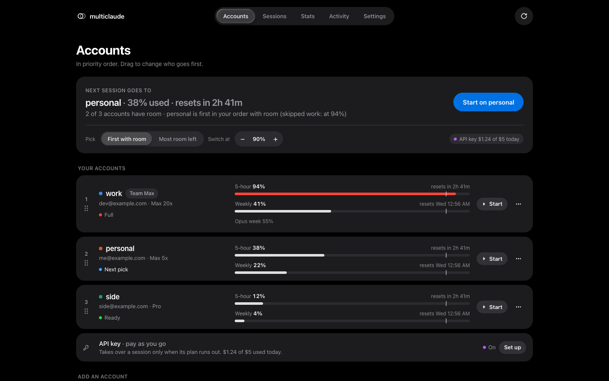
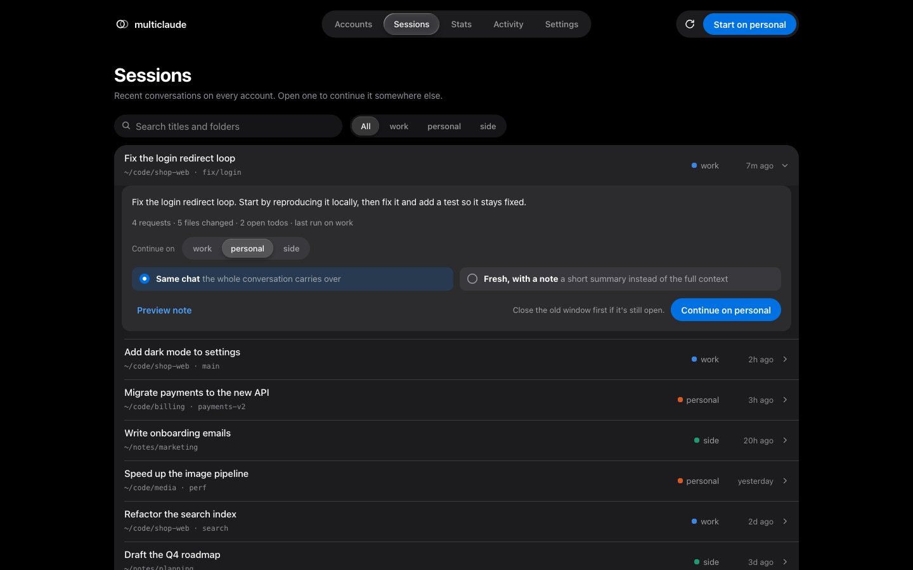
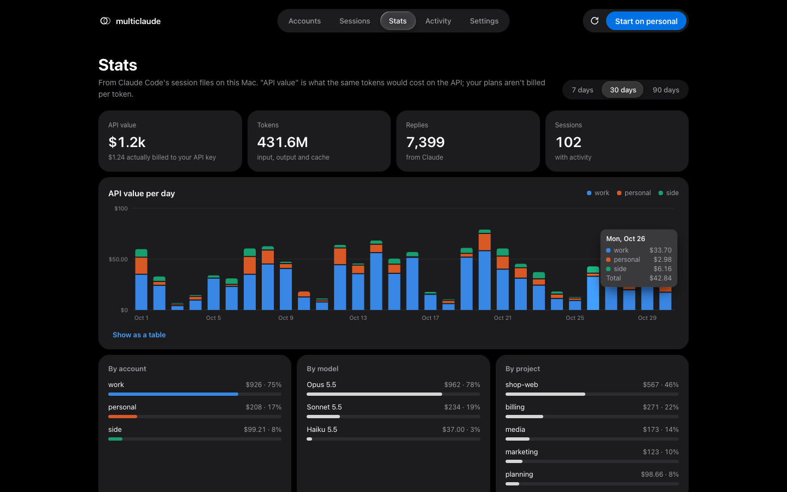
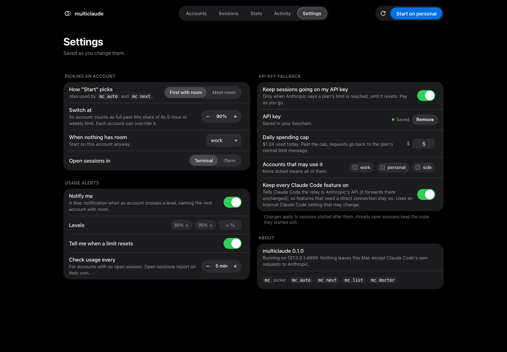
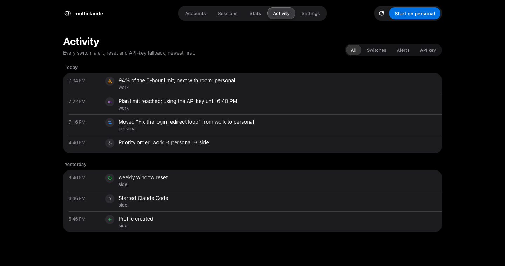
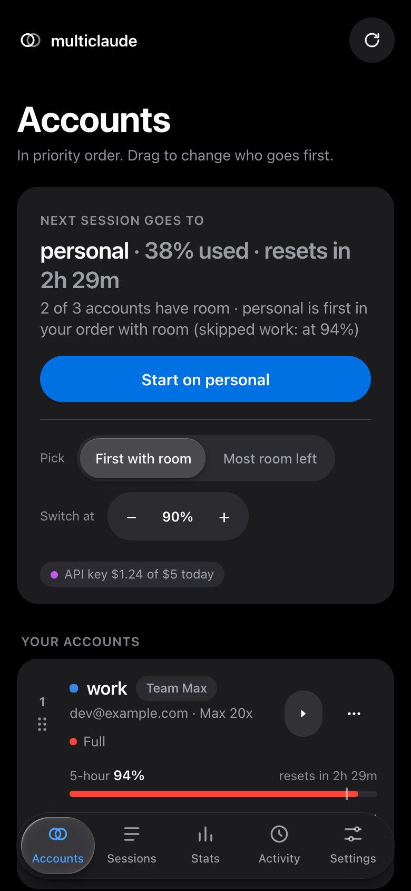

<div align="center">

# multiclaude

**Several Claude Pro / Max accounts in one Claude Code, on your own computer (macOS, Windows, Linux).**

Put your accounts in priority order, type `claude`, and it starts on the first one that still has room.
Live usage for every account in a dashboard, the menu bar, the terminal and Claude Code's status line.

[Install](#install) · [Quick start](#quick-start) · [Usage guide](docs/usage.md) · [Setup guide](docs/setup.md) ·
[Configuration](docs/configuration.md) · [How it works](docs/how-it-works.md) · [Troubleshooting](docs/troubleshooting.md)

[](https://github.com/subh05sus/multiclaude/releases/latest)
[](https://github.com/subh05sus/multiclaude/actions/workflows/ci.yml)




</div>

## What it does

- **One profile per Claude account.** Each keeps its own login. Everything else is shared: chat history,
  memory, settings, hooks, `CLAUDE.md`, skills, plugins, mods, commands, agents and MCP servers.
- **Priority order.** You decide which account goes first and at what usage level each one counts as full
  ("switch at", 90% by default). Pick strictly by order, or by most room left.
- **Plain `claude` picks for you** (optional). After `mc shell on`, typing `claude` starts on the right account.
  Commands like `claude mcp add` or `claude update` still run normally.
- **Live usage** for every account's 5-hour and weekly limits (and per-model weekly limits on plans that have
  them) in:
  - a local web dashboard,
  - a menu bar app,
  - a terminal picker,
  - Claude Code's own status line.
- **Alerts** as desktop notifications when an account crosses 80% and 95% (you choose the levels), naming the next
  account with room, and again when a limit resets.
- **Move a session in one click.** Press **Move to <account>** under the prompt or in the menu bar, or run `mc next`, and
  the conversation reopens on the next account with room, with the whole context. `mc next --fresh` starts clean there with a short handover note instead.
- **Auto-resume.** When a session stops at its account's usage limit, it waits for that account to reset,
  then continues by itself, picking up where it left off. The notification also names another account with room,
  in case you'd rather `mc next` now.
- **Optional paid API-key fallback.** When Anthropic answers that a plan's limit is reached, a local relay resends
  that request on your own API key until the plan resets, up to a daily dollar cap you set.
- **Stats** from Claude Code's session files on your computer: what your work would have cost at API prices, per day,
  account, model and project.
- **Encrypted export** to move your setup to another computer.

### What it deliberately doesn't do

It never moves a running conversation to another Claude account by itself (auto-resume waits for the *same*
account to reset). Pooling subscriptions to get around
their usage limits is against Anthropic's terms and can get accounts banned, so switching accounts is always your
click (**Move to <account>**) or your command (`mc next`). The only automatic switch is to **your own API key**, which you pay for per
request.

## Screenshots

| Sessions: continue any conversation on another account | Stats: API value per day, by account |
|---|---|
|  |  |
| **Settings: picking, alerts, API fallback** | **Activity: every switch, alert and fallback** |
|  |  |

<p align="center"></p>

The screenshots use sample data (`npm run demo` serves it, so you can try the dashboard without an account).

## Requirements

- **macOS 13+, Windows 10/11, or Linux.** Everything works on all three except the menu bar app, which is macOS
  only (the dashboard does the same job). See [Windows](#windows) below.
- **Node.js 22.18+ or 23.6+** (multiclaude runs its TypeScript directly, with no build step).
- **Claude Code** installed and signed in (`claude --version` works).
- One or more **Claude Pro or Max** accounts. An Anthropic API key is optional, for the fallback.

## Install

### Install with an agent

Paste this into Claude Code and it does the install for you. You only step in to answer its questions and sign in to
your accounts.

```text
Install multiclaude for me from https://github.com/subh05sus/multiclaude. Read its README first.

1. Check the requirements: Node.js 22.18+, git, and Claude Code signed in. If something is missing, tell me how to
   get it and stop.
2. Clone the repo to ~/multiclaude. If it's already there, pull the latest instead.
3. Tell me what setup will change on my computer, then ask me whether plain `claude` should pick an account by
   itself (the --shell option).
4. Run `./bin/mc setup`, with --shell if I said yes. On macOS without the Xcode command line tools, add
   --no-menubar. On Windows, use the commands in the README's Windows section.
5. Run `mc doctor` (or `./bin/mc doctor` if mc isn't on the PATH yet) and fix anything it flags.
6. Ask me what to call each extra Claude account. Signing in opens a browser, so don't run this yourself: tell me to
   type `! mc add <name>` at the prompt for each one, and wait until I've done them.
7. Ask me which account to try first and run `mc order` with my answer.
8. Finish by telling me how to start a session, the dashboard address, and to open a new terminal tab.
```

### Install by hand

```sh
git clone https://github.com/subh05sus/multiclaude.git ~/multiclaude
cd ~/multiclaude
./bin/mc setup --shell
```

`mc setup --shell`:

1. puts `mc` on your PATH (`~/.local/bin/mc`, where Claude Code's own launcher lives);
2. adds a status line and a session hook to `~/.claude/settings.json`, keeping a backup next to it (an existing
   status line keeps showing first);
3. starts the background service at login (LaunchAgent `com.multiclaude.daemon`, port 4880, localhost only);
4. builds the menu bar app into `~/.multiclaude/MultiClaude.app` and opens it at login (needs the Xcode command
   line tools for `swiftc`; skip it with `--no-menubar`);
5. installs the small `multiclaude-move` plugin that draws the **Move to <account>** button under the prompt;
6. with `--shell`, makes plain `claude` pick an account (adds a small function to `~/.zshrc` / `~/.bashrc` /
   fish, between marker lines).

Then **open a new terminal tab** and check everything with `mc doctor`.

### Windows

In PowerShell (Node.js and Claude Code installed, `git` available):

```powershell
git clone https://github.com/subh05sus/multiclaude.git $HOME\multiclaude
node --disable-warning=ExperimentalWarning $HOME\multiclaude\src\cli.ts setup --shell
```

- `mc.cmd` goes into `%USERPROFILE%\.local\bin` (where Claude Code's own `claude.exe` lives, already on PATH).
- The service starts at login from your Startup folder (`multiclaude.vbs`, runs hidden, no admin rights).
- `claude` picks an account in PowerShell and Git Bash. If PowerShell says scripts are disabled, run once:
  `Set-ExecutionPolicy -Scope CurrentUser RemoteSigned`. In plain cmd.exe, use `mc auto`.
- Notifications are Windows toasts; Start buttons open Windows Terminal (or a console window).
- Shared folders are directory junctions; shared files are symlinks when Developer Mode is on, hard links
  otherwise. Neither needs admin rights.

Linux: the same `./bin/mc setup --shell`; the service runs as a systemd user unit.

Your existing `~/.claude` becomes the profile called **main**. Nothing in it moves.

**Releases:** every version is on the [releases page](https://github.com/subh05sus/multiclaude/releases), with
its changes, a source zip (an alternative to `git clone`) and the prebuilt macOS menu bar app.

There's nothing to `npm install` to run it. `npm install` only fetches the TypeScript types for development.

## Quick start

```sh
mc add work --label "Team Max"   # a browser window opens: sign in with that Claude account
mc add personal                  # one profile per account
mc order work personal main      # first = tried first
mc set main switch-at 80         # optional: main counts as full at 80%

claude                           # starts on the first account in your order with room
                                 # (or: mc auto, or mc to choose in a picker)
```

When the account you're on fills up, you get a notification naming the next one with room. Then, in the same
folder:

```sh
mc next            # same conversation, next account with room
mc next --fresh    # or: a fresh session there with a handover note
```

Open the dashboard with `mc ui` (http://127.0.0.1:4880), or use the menu bar icon.

## Everyday commands

| Command | What it does |
|---|---|
| `claude` | With `mc shell on`: starts on the account `mc auto` would pick. Without it: plain Claude Code on main |
| `mc` | Terminal picker with every account's usage. ↵ start · `a` auto-pick · `r` resume here · `J`/`K` reorder · `p` pause · `d` dashboard |
| `mc auto [args]` | Start on the first account with room (or most room, see `mc pick`) |
| `mc <name> [args]` | Start on a given account. Any `claude` arguments work: `mc work -p "hi"`, `mc work --resume` |
| `mc next [--fresh]` | Move this folder's latest session to the next account with room |
| `mc resume <name> [id]` | Continue a session on an account (default: the latest in this folder) |
| `mc list` | Accounts, usage, order and what `mc auto` would pick |
| `mc ui` | Open the dashboard |

Full reference, with every flag: **[docs/usage.md](docs/usage.md)**.

## Docs

| Guide | What's in it |
|---|---|
| [Setup](docs/setup.md) | Install step by step, adding accounts, the API key, permissions macOS asks for, updating, uninstalling |
| [Usage](docs/usage.md) | Every command; the picker, dashboard, menu bar and status line; alerts, sessions, handover, stats, export |
| [Configuration](docs/configuration.md) | `~/.multiclaude/config.json` field by field, environment variables, every file multiclaude writes |
| [How it works](docs/how-it-works.md) | Profiles and sharing, usage sources, picking, the relay, stats, security model |
| [Troubleshooting](docs/troubleshooting.md) | Common problems and fixes, FAQ |
| [Decisions](docs/decisions.md) | Product and design decisions and why |

## Privacy and security

- Everything runs on your machine. The service listens on `127.0.0.1` only and refuses requests addressed to any
  other host name, so a web page can't reach it.
- Logins stay where Claude Code keeps them (the macOS Keychain, or `.credentials.json` in each profile on
  Windows and Linux). multiclaude reads them only to ask Anthropic for
  that account's usage, and never refreshes or copies them, except into an encrypted export you ask for.
- The API key is stored in the Keychain on macOS (item `multiclaude-api-key`), or in `~/.multiclaude/api-key`,
  readable only by you, on Windows and Linux.
- Changes from the dashboard need a random token that only the dashboard page and the menu bar app can read.
- The only network traffic is Claude Code's own requests to `api.anthropic.com`, plus the usage check
  (`/api/oauth/usage`) every few minutes for accounts with no open session.

## Develop

```sh
npm install      # TypeScript types only
npm test         # relay fallback against a fake Anthropic, picking, usage, links, stats, handover, export, shell
npm run check    # tsc --noEmit
npm run lint     # design guard: no side-edge accents, no clipped focus rings, no raw colours in the UI
npm run demo     # the dashboard with sample data on http://127.0.0.1:4899
```

Releasing: bump `version` in `package.json`, add a `## <version> — <date>` section to `CHANGELOG.md`, commit,
then `git tag -a v<version> -m "multiclaude <version>" && git push origin main v<version>`. The
[release workflow](.github/workflows/release.yml) tests, builds the menu bar app and publishes the release with
notes from the changelog.

Layout: `src/` (TypeScript, run directly by Node), `web/` (the dashboard: plain HTML, CSS and JS), `menubar/`
(Swift), `test/`, `scripts/`, `docs/`.

## Disclaimer

multiclaude is an independent project, not made by or affiliated with Anthropic. "Claude" and "Claude Code" are
Anthropic's. You're responsible for using your accounts within
[Anthropic's terms](https://www.anthropic.com/legal/consumer-terms). multiclaude reads one internal Claude Code
setting and two unofficial endpoints and headers, any of which can change with a Claude Code update; see
[How it works](docs/how-it-works.md).

## License

[MIT](LICENSE)
